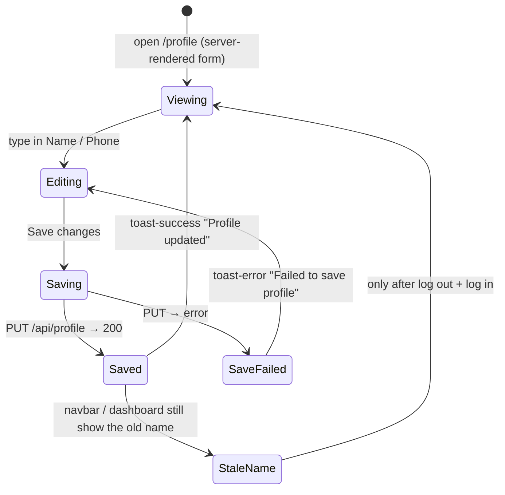
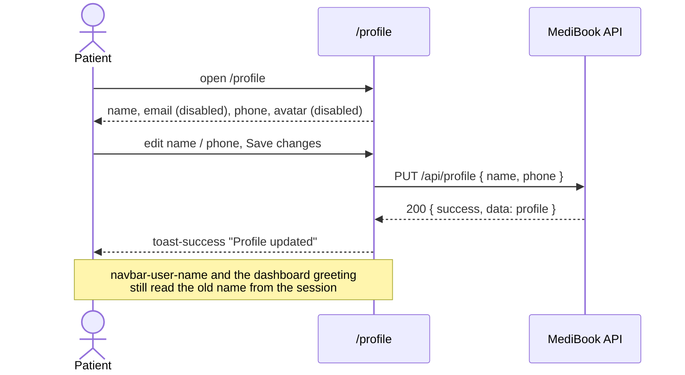

# Feature Map — MEDIC-108 Patient Profile Management

Author: Adriana Chipana · Track: Development · Day: Friday (capstone)

Built from the `/profile` screen, the network calls it makes and the `data-testid` audit (`evidence/profile-hook-audit.json`).

**Result:**
- **Pass** — matches the reference rule.
- **Fail** — breaks it.
- **Not verified** — not checked.

## States

## Flow

## Entries

### FM-01 — Viewing

- **Actor:** signed-in patient
- **Trigger:** open `/profile`
- **Expected Result:** current name, email, phone shown; email read-only; avatar upload disabled with "not yet implemented"
- **API Call:** none from the browser (server-rendered)
- **Error / Alternate Path:** no session → 307 to `/login`
- **Hooks:** `profile-card`, `profile-form`, `profile-name-input`, `profile-email-input`, `profile-phone-input`, `profile-avatar-input`, `profile-save-btn`
- **Test Data Needed:** P3
- **Result:** Pass

### FM-02 — Save valid changes

- **Actor:** signed-in patient
- **Trigger:** change name and phone, Save changes
- **Expected Result:** 200; success notification; values persist after reload
- **API Call:** `PUT /api/profile` with `{ name, phone }`
- **Error / Alternate Path:** server error → `toast-error` "Failed to save profile" (forced with `page.route`)
- **Hooks:** `toast-success`, `toast-error`
- **Test Data Needed:** P3
- **Result:** Pass — automated in `tests/profile-ui.spec.ts`

### FM-03 — Saving

- **Actor:** signed-in patient
- **Trigger:** Save changes, while the request is in flight
- **Expected Result:** button disabled, so a double save can't be sent
- **API Call:** `PUT` in flight
- **Error / Alternate Path:** —
- **Hooks:** `profile-save-btn` (text "Saving…", `disabled`); no dedicated saving hook
- **Test Data Needed:** P3
- **Result:** Pass

### FM-04 — Name shown after a change

- **Actor:** patient
- **Trigger:** after FM-02, look at the navbar and dashboard (same tab, after navigation, after reload)
- **Expected Result:** the new name everywhere (BR-PROF-006)
- **API Call:** `GET /api/auth/session` still returns the old name
- **Error / Alternate Path:** —
- **Hooks:** `navbar-user-name`, `page-title`
- **Test Data Needed:** P2
- **Result:** **Fail** — old name until log out and log in (`bug-report.md`)

### FM-05 — Invalid name

- **Actor:** patient / API client
- **Trigger:** 1 character, 51 or 200 characters, whitespace-only
- **Expected Result:** rejected with an inline error / 400 (BR-PROF-005)
- **API Call:** `PUT /api/profile`
- **Error / Alternate Path:** —
- **Hooks:** no field-level error hook exists
- **Test Data Needed:** P3
- **Result:** **Fail** — all accepted (200). Whitespace-only is stored as an empty name, with a "Profile updated" toast.

### FM-06 — Invalid phone

- **Actor:** patient / API client
- **Trigger:** `INVALID_PHONE_123`
- **Expected Result:** rejected (BR-PROF-004)
- **API Call:** `PUT /api/profile`
- **Error / Alternate Path:** —
- **Hooks:** no field-level error hook
- **Test Data Needed:** P3
- **Result:** **Fail** — accepted (200)

### FM-07 — Identity fields

- **Actor:** API client (patient session)
- **Trigger:** `PUT` with `email` and `role`
- **Expected Result:** both ignored or rejected (BR-PROF-002)
- **API Call:** `PUT /api/profile`
- **Error / Alternate Path:** —
- **Hooks:** UI: `profile-email-input` disabled
- **Test Data Needed:** P4
- **Result:** Pass — automated in `tests/profile-api.spec.ts`

### FM-08 — No session

- **Actor:** anonymous client
- **Trigger:** `PUT` / `GET /api/profile` without a cookie
- **Expected Result:** 401 `UNAUTHORIZED` (BR-PROF-003)
- **API Call:** `PUT /api/profile`
- **Error / Alternate Path:** —
- **Hooks:** —
- **Test Data Needed:** none
- **Result:** Pass — automated (reference AC SC-03). The 401 has an empty `message`.

### FM-09 — Special characters

- **Actor:** patient
- **Trigger:** name with ``
- **Expected Result:** rendered as plain text, nothing executed
- **API Call:** `PUT /api/profile`
- **Error / Alternate Path:** —
- **Hooks:** `profile-name-input`
- **Test Data Needed:** P3
- **Result:** Pass on the profile screen. Other screens were not verified, because they keep the old name (FM-04).

### FM-10 — Audit

- **Actor:** clinic / admin
- **Trigger:** any successful change
- **Expected Result:** one audit entry per change (BR-PROF-007)
- **API Call:** —
- **Error / Alternate Path:** —
- **Hooks:** —
- **Test Data Needed:** —
- **Result:** Not verified — no audit endpoint or screen exists (feature never built)
