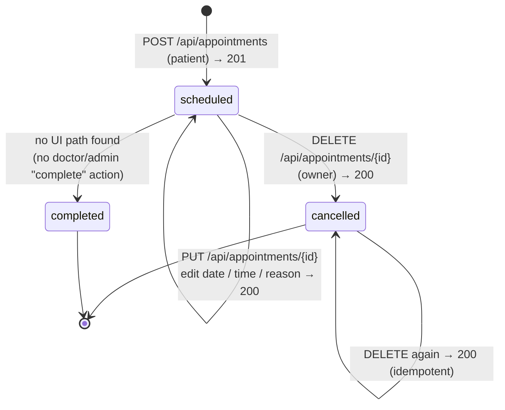
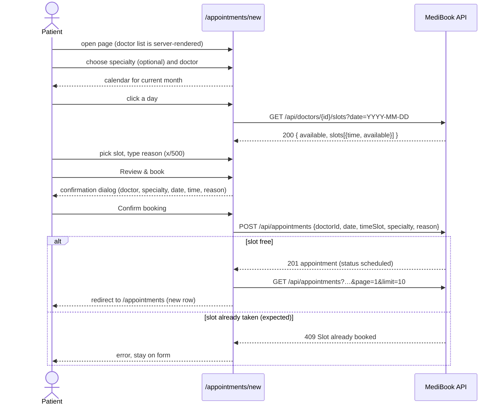
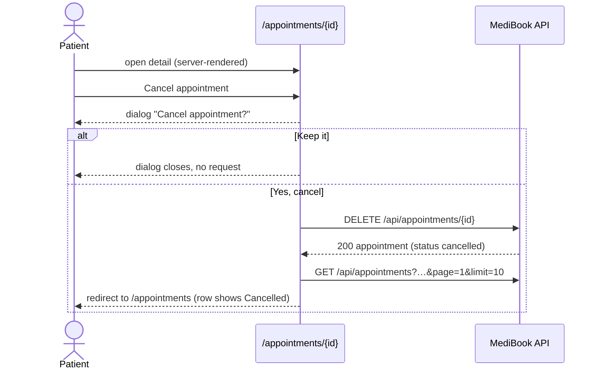

# Feature Map — Appointment Booking & Cancellation

Author: Adriana Chipana · Track: Development · Day: Tuesday

Covers happy paths, alternate paths, error paths, states, transitions and API calls for **booking** and **cancelling** an appointment, plus **edit** because it is reached from the same detail screen. Built from the site map ([site-map.md](site-map.md)), a full booking → edit → cancel run captured on 2026-09-29, and Monday's findings.

- **Expected** = what the feature should do: the business rules confirmed by the mentor on 2026-09-29 (see the test plan), the UI copy and the API's documented status codes.
- **Result** = what the app did when checked: **Pass** (matches expected), **Fail** (differs — Monday bug id in Notes), **Partial** (some paths pass, some fail) or **Not verified**.
- Evidence file names refer to [`evidence/`](evidence/README.md).

## Appointment states

- **(new) → scheduled** — Trigger: Confirm booking · Who: patient · API: `POST /api/appointments` → 201 · Result: Pass · Notes: `api-01`
- **scheduled → scheduled** — Trigger: Edit → Save changes · Who: owning patient · API: `PUT /api/appointments/{id}` → 200 · Result: Partial · Notes: Saves, but accepts any date/time (BUG-05) · `api-02`
- **scheduled → cancelled** — Trigger: Cancel appointment → Yes, cancel · Who: owning patient · API: `DELETE /api/appointments/{id}` → 200 · Result: Pass · Notes: `api-03`
- **scheduled → completed** — Who: doctor, clinic or system only · Result: Not verified · Notes: No doctor/clinic path exists in this build; completed rows exist only as program seed data. A patient attempt must get 403/400 (mentor rule 4)
- **cancelled → cancelled** — Trigger: Cancel again (API) · Who: owning patient · API: `DELETE` → 200 · Result: Pass · Notes: Idempotent · `api-03`
- **any → any** — Trigger: Any write · Who: doctor · API: `POST` / `PUT` / `DELETE` → 403 · Result: Pass · Notes: `api-06`
- **scheduled → approved / completed by a patient** — Trigger: `PUT` with `status` · Who: owning patient · API: → 200 · Result: Fail · Notes: Must be 403/400 — only the doctor, clinic or system may set these (BUG-05, mentor rule 4)
- **scheduled → cancelled by clinic / admin / system** — Who: not the patient · Result: Not verified · Notes: Expected behaviour (mentor rule 7); the patient should see who cancelled and why. Observed once: 4 of the own account's appointments were cancelled on 2026-09-28 at 23:44 with no reason shown

## Booking flow

## Cancellation flow

## Feature map rows — booking

#### FM-B01 — Book appointment, nothing selected

- **Actor:** Patient
- **Trigger:** Open `/appointments/new`
- **Expected Result:** Specialty + doctor selects and reason box shown; calendar hidden; Review & book disabled
- **API Call:** none (server-rendered doctor list)
- **Error / Alternate Path:** Doctor opens the URL → redirected to `/appointments` · No session → 307 `/login`
- **Test Data Needed:** P1
- **Result:** Pass
- **Notes:** Doctor redirect and no-session redirect both observed (`api-05`)

#### FM-B02 — Specialty filter

- **Actor:** Patient
- **Trigger:** Choose a specialty
- **Expected Result:** Doctor list shows only that specialty; every specialty with a doctor is listed
- **API Call:** none
- **Error / Alternate Path:** "All specialties" resets the list
- **Test Data Needed:** D1–D3
- **Result:** Fail
- **Notes:** 4 specialties missing from the filter (BUG-22)

#### FM-B03 — Doctor chosen, calendar

- **Actor:** Patient
- **Trigger:** Choose a doctor
- **Expected Result:** Current month shown; only the doctor's working days clickable; past days disabled; today only for slots that start at least the minimum lead time (e.g. 15 min) from now
- **API Call:** none
- **Error / Alternate Path:** Next / previous month buttons
- **Test Data Needed:** D1 (Mon–Fri), D3 (Tue/Thu)
- **Result:** Partial
- **Notes:** Weekends disabled; past weekdays still clickable (BUG-04)

#### FM-B04 — Day chosen, slot grid

- **Actor:** Patient
- **Trigger:** Click a day
- **Expected Result:** Slots within working hours (start + duration ≤ closing); booked slots disabled
- **API Call:** `GET /api/doctors/{id}/slots?date=` → 200
- **Error / Alternate Path:** Non-working day → `available:false`, no slots · missing date → 400 · malformed doctor id → 400 expected
- **Test Data Needed:** A03 (last valid slot), A08 (booked slot)
- **Result:** Fail
- **Notes:** Non-working day and missing date behave as expected (`api-04`). Booked slots never disabled — D1 2026-10-20 07:00 (seed A01) still clickable (BUG-03, `ui-01`). Last slot ends after closing (BUG-10). Malformed id → 500

#### FM-B05 — Slot + reason

- **Actor:** Patient
- **Trigger:** Pick slot, type reason
- **Expected Result:** Counter updates x/500; Review & book enabled only when doctor, day, slot and reason are set
- **API Call:** none
- **Error / Alternate Path:** Empty or spaces-only reason → disabled · more than 500 chars → blocked
- **Test Data Needed:** P1
- **Result:** Partial
- **Notes:** Empty / spaces-only keep the button disabled; typing is capped by `maxlength=500`, but a longer value set by script still enables submit (`ui-01`). API returns 500 for 600 chars (BUG-13)

#### FM-B06 — Confirmation dialog

- **Actor:** Patient
- **Trigger:** Review & book
- **Expected Result:** Dialog repeats doctor, specialty, date, time, reason
- **API Call:** none
- **Error / Alternate Path:** Cancel or close (X) → back to form, nothing booked
- **Test Data Needed:** P1
- **Result:** Pass
- **Notes:** `fm-01`; dialog Cancel sends no request (`ui-01`)

#### FM-B07 — Submitting

- **Actor:** Patient
- **Trigger:** Confirm booking
- **Expected Result:** Appointment created as `scheduled`; redirect to list
- **API Call:** `POST /api/appointments` → 201 (`api-01`)
- **Error / Alternate Path:** Slot taken → 409 · missing fields → 400 · no session → 401 · doctor → 403 · unknown doctor → 404
- **Test Data Needed:** A08 + P5 for the 409 case
- **Result:** Partial
- **Notes:** 400, 401 and 403 as expected (`api-04`, `api-05`, `api-06`). Taken slot returns 201 (BUG-01, BUG-02); unknown doctor returns 201 (BUG-08)

#### FM-B08 — After booking

- **Actor:** Patient
- **Trigger:** Redirect
- **Expected Result:** New row in list and dashboard with the booked date/time; success message
- **API Call:** `GET /api/appointments?…` → 200
- **Error / Alternate Path:** Same date/time on dashboard, list, detail and doctor schedule
- **Test Data Needed:** A01
- **Result:** Fail
- **Notes:** No success toast (BUG-26 — confirmed as a UX bug by the mentor: without feedback users click again and create duplicates). List/detail time shifted −5h (BUG-06): the 2026-10-14 10:00 booking shows as Oct 13, 05:00 AM on the detail page (`fm-02`)

## Feature map rows — cancellation

#### FM-C01 — Detail, scheduled

- **Actor:** Owning patient
- **Trigger:** Open `/appointments/{id}`
- **Expected Result:** Doctor, specialty, date, time, reason, doctor contact; Edit and Cancel appointment buttons
- **API Call:** none (server-rendered)
- **Error / Alternate Path:** Other patient's id → "not found" / API 404 · doctor → read-only detail · past appointment → no Edit / Cancel
- **Test Data Needed:** A02, A09
- **Result:** Partial
- **Notes:** Detail shown (`fm-02`); other patient → 404 (`api-04`). Doctor sees "not found" (BUG-12); past appointment still editable (BUG-27)

#### FM-C02 — Cancel dialog

- **Actor:** Owning patient
- **Trigger:** Cancel appointment
- **Expected Result:** Dialog "Cancel appointment?" with Keep it / Yes, cancel
- **API Call:** none
- **Error / Alternate Path:** Close (X) closes the dialog
- **Test Data Needed:** A02
- **Result:** Pass
- **Notes:** `fm-03`

#### FM-C03 — Keep it

- **Actor:** Owning patient
- **Trigger:** Keep it
- **Expected Result:** Dialog closes; appointment stays scheduled
- **API Call:** none
- **Error / Alternate Path:** —
- **Test Data Needed:** A02
- **Result:** Pass
- **Notes:** No request sent (`api-03` note)

#### FM-C04 — Confirm cancel

- **Actor:** Owning patient
- **Trigger:** Yes, cancel
- **Expected Result:** Status becomes `cancelled`; redirect to list
- **API Call:** `DELETE /api/appointments/{id}` → 200 (`api-03`)
- **Error / Alternate Path:** Other patient → 404 · doctor → 403 · no session → 401 · already cancelled → 200 (idempotent)
- **Test Data Needed:** A02 (cancel), A09 (P1 tries P5's)
- **Result:** Pass
- **Notes:** All four alternate paths observed (`api-03` to `api-06`)

#### FM-C05 — After cancel

- **Actor:** Patient
- **Trigger:** Redirect
- **Expected Result:** Row shows Cancelled; appears under the Cancelled filter; slot bookable again
- **API Call:** `GET /api/appointments?…` → 200
- **Error / Alternate Path:** Another patient books the released slot
- **Test Data Needed:** A06 → A07
- **Result:** Partial
- **Notes:** Re-book works (seed A07); Cancelled badge is green (BUG-21)

#### FM-C06 — Cancelled detail

- **Actor:** Owning patient
- **Trigger:** Open a cancelled appointment
- **Expected Result:** Read-only; no Cancel / Edit
- **API Call:** none
- **Error / Alternate Path:** —
- **Test Data Needed:** A04
- **Result:** Pass
- **Notes:** No buttons shown (`ui-01`)

#### FM-C07 — Cancellation notice

- **Actor:** Patient, doctor
- **Trigger:** After cancel
- **Expected Result:** Patient sees confirmation; doctor's schedule shows the row as cancelled
- **API Call:** —
- **Error / Alternate Path:** —
- **Test Data Needed:** A02 + doctor view
- **Result:** Fail
- **Notes:** No toast. Doctor view of a freshly seeded cancel not checked yet

## Feature map rows — edit (alternate path from detail)

#### FM-E01 — Edit mode

- **Actor:** Owning patient
- **Trigger:** Edit
- **Expected Result:** Date, time and reason inputs prefilled; Save changes / Cancel
- **API Call:** none
- **Error / Alternate Path:** Cancel → back to view, nothing saved
- **Test Data Needed:** A05
- **Result:** Pass
- **Notes:** —

#### FM-E02 — Save

- **Actor:** Owning patient
- **Trigger:** Save changes
- **Expected Result:** Saved only if the new date/time is a free, valid slot for that doctor
- **API Call:** `PUT /api/appointments/{id}` → 200 (`api-02`)
- **Error / Alternate Path:** Past date, off-grid time, taken slot → 400 / 409
- **Test Data Needed:** A05 (moved +7 days by the seed)
- **Result:** Fail
- **Notes:** Any date/time accepted (BUG-05)

## Known limitations

- Expected results now rest on the mentor's rulings of 2026-09-29; there are still no written acceptance criteria, and the minimum lead time (e.g. 15 minutes) needs an exact value.
- The `completed` state can't be reached through the UI, so any test that needs it depends on pre-seeded data (see [test-data-sheet.md](test-data-sheet.md)).
- Still not verified: the doctor-side view of a freshly seeded cancellation (FM-C07). Check it before writing Wednesday's scenarios.
