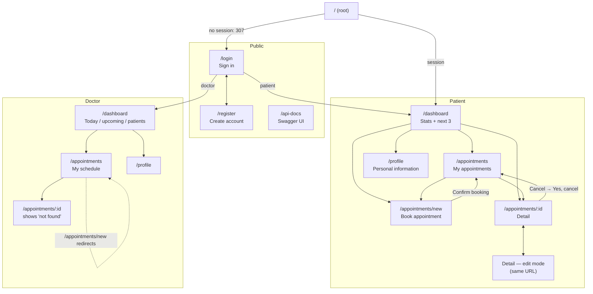

# Site Map — MediBook

Author: Adriana Chipana · Track: Development · Day: Tuesday

Mapped on 2026-09-29 against https://medapp-nerdery.vercel.app with the patient role, the doctor role and no session. Every page below was opened; the API calls were read from the browser network log and the `data-testid` hooks from the rendered HTML. Evidence: [`evidence/README.md`](evidence/README.md).

## Map

Pages are shared between roles: `/dashboard`, `/appointments` and `/profile` render a different view for the doctor. There is no separate admin UI: `/admin`, `/admin/settings`, `/doctor`, `/doctors`, `/settings` and `/schedule` all return 404. The admin role exists only in the API (`/api/admin/settings`, not explored — out of scope).

## Route summary

How each route behaves per role, and which calls the browser makes:

- **`/`** — patient or doctor: goes to `/dashboard` · no session: 307 → `/login`
- **`/login`** — open to everyone · rendered in the browser · calls `GET /api/auth/providers`, `GET /api/auth/csrf`, `POST /api/auth/callback/credentials`, `GET /api/auth/session`
- **`/register`** — open to everyone · rendered in the browser · calls `POST /api/auth/register` ¹
- **`/api-docs`** — open to everyone · Swagger UI · loads `GET /api/openapi` ¹
- **`/dashboard`** — patient view / doctor view · no session: 307 → `/login` · rendered on the server, so the browser makes no data call
- **`/appointments`** — patient: "My appointments" · doctor: "My schedule" · no session: 307 → `/login` · calls `GET /api/appointments?search=&status=all&sort=date&order=desc&page=1&limit=10`
- **`/appointments/new`** — patient only; a doctor is redirected to `/appointments` · no session: 307 → `/login` · calls `GET /api/doctors/{id}/slots?date=YYYY-MM-DD` and `POST /api/appointments`
- **`/appointments/:id`** — own appointments only (other ids show "not found"); the doctor sees "Appointment not found" · no session: 307 → `/login` · rendered on the server · calls `PUT /api/appointments/{id}` (edit) and `DELETE /api/appointments/{id}` (cancel)
- **`/profile`** — patient and doctor · no session: 307 → `/login` · calls `PUT /api/profile` on save ¹
- **Any other path** — 404 for everyone

¹ Not traced in the network log (no form was submitted on these pages); taken from the API docs. All other calls were observed.

## Site map entries

### `/login`

- **Area / Page:** Sign in
- **Sub-pages or states:** empty form (Sign in disabled) · filled · submitting ("Signing in…") · error "Invalid email or password"
- **Roles with access:** everyone; a logged-in user is sent to `/dashboard`
- **Key actions:** sign in; go to Register
- **API dependencies:** NextAuth — `GET /api/auth/csrf`, `POST /api/auth/callback/credentials`, `GET /api/auth/session`
- **Test hooks:** `login-email-input`, `login-password-input`, `login-submit-btn`, `login-register-link`

### `/register`

- **Area / Page:** Create an account
- **Sub-pages or states:** empty form · validation error · success (then sign in)
- **Roles with access:** everyone
- **Key actions:** create a patient account (name, email, password, confirm password, accept terms)
- **API dependencies:** `POST /api/auth/register` ¹ (201 created · 400 validation · 409 email taken — status codes observed on Monday via direct API calls)
- **Test hooks:** `register-name-input`, `register-email-input`, `register-password-input`, `register-confirm-input`, `register-terms-checkbox`
- **Evidence:** `evidence/sm-01-register.png`

### `/dashboard` — patient

- **Area / Page:** Welcome back, overview
- **Sub-pages or states:** with upcoming appointments · no upcoming appointments (not observed)
- **Roles with access:** patient
- **Key actions:** Book new → `/appointments/new`; open one of the next 3 appointments → `/appointments/:id`
- **API dependencies:** server-rendered; the browser makes no data call. Values: total, upcoming (7 days), completed, next 3 scheduled.
- **Test hooks:** `dashboard-new-appointment-btn`, `stat-total-value`, `dashboard-upcoming-count`, `stat-completed-value`, `dashboard-upcoming-list`, `dashboard-appointment-<id>`, `status-badge-<status>`
- **Evidence:** `evidence/sm-02-patient-dashboard.png`

### `/dashboard` — doctor

- **Area / Page:** Welcome back, Dr. …, specialty
- **Sub-pages or states:** with / without appointments today
- **Roles with access:** doctor
- **Key actions:** read-only overview; next 5 appointments with patient name and reason
- **API dependencies:** server-rendered
- **Test hooks:** `doctor-specialty`, `stat-today-value`, `stat-upcoming-value`, `stat-completed-value`, `stat-patients-value`, `doctor-next-appointments`, `doctor-appt-patient`
- **Evidence:** `evidence/sm-06-doctor-dashboard.png`

### `/appointments` — patient ("My appointments") and doctor ("My schedule")

- **Area / Page:** appointment list
- **Sub-pages or states:** loading · rows · empty ("No appointments found") · filtered · sorted asc/desc · paginated (10 per page)
- **Roles with access:** patient (own appointments, Doctor column), doctor (own schedule, Patient column)
- **Key actions:** search by reason or specialty; filter by status (all / scheduled / completed / cancelled); sort by date or specialty; Prev/Next page; View → detail; patient only: New appointment
- **API dependencies:** `GET /api/appointments` with `search`, `status`, `sort`, `order`, `page`, `limit`
- **Test hooks:** `appointments-search-input`, `appointments-status-filter`, `appointments-table`, `appointments-sort-date`, `appointments-sort-specialty`, `appointments-loading`, `pagination-info`, `pagination-prev`, `pagination-next`, `new-appointment-btn` (patient); per row: `appointment-row-<id>`, `cell-date`, `cell-time`, `cell-doctor`, `cell-specialty`, `status-badge-<status>`, `view-link-<id>`
- **Evidence:** `evidence/sm-04-patient-appointments-list.png`, `evidence/sm-07-doctor-schedule.png`, `evidence/sm-08-list-loading-state.png` (loading state)

### `/appointments/new`

- **Area / Page:** Book appointment
- **Sub-pages or states:** no doctor chosen (calendar hidden) · doctor chosen (calendar, month navigation) · day chosen (slot grid) · slot chosen · reason typed (counter x/500) · confirmation dialog · submitting
- **Roles with access:** patient; doctor is redirected to `/appointments`
- **Key actions:** filter doctors by specialty; choose doctor, day, time slot; type reason; Review & book → Confirm booking / Cancel
- **API dependencies:** doctor list server-rendered; `GET /api/doctors/{id}/slots?date=` per day clicked; `POST /api/appointments` on confirm
- **Test hooks:** `appointment-form-specialty-select`, `appointment-form-doctor-select`, `calendar-prev-month`, `calendar-next-month`, `calendar-day-<YYYY-MM-DD>`, `time-slot-<HH:MM>`, `appointment-form-reason-textarea`, `reason-char-count`, `appointment-form-cancel-btn`, `appointment-form-submit-btn`, `confirmation-modal`, `confirm-doctor|specialty|date|time|reason`, `confirmation-modal-confirm-btn`, `confirmation-modal-cancel-btn`
- **Evidence:** `evidence/sm-03-booking-form-slots.png`, `evidence/fm-01-booking-confirm-dialog.png`, `evidence/api-01-book-post-appointment.json`

### `/appointments/:id`

- **Area / Page:** appointment detail
- **Sub-pages or states:** view · edit mode (date, time, reason) · cancel confirmation dialog · not found (someone else's id, doctor role)
- **Roles with access:** owning patient; doctor sees "Appointment not found" in the UI although the API returns the data (Monday BUG-12)
- **Key actions:** Back to appointments; Edit → Save changes / Cancel; Cancel appointment → Yes, cancel / Keep it
- **API dependencies:** detail server-rendered; `PUT /api/appointments/{id}` on save; `DELETE /api/appointments/{id}` on cancel
- **Test hooks:** `back-to-list`, `appointment-detail-card`, `appointment-doctor-name`, `appointment-specialty`, `appointment-date`, `appointment-time`, `appointment-reason`, `doctor-email`, `doctor-phone`, `edit-appointment-btn`, `cancel-appointment-btn`, `edit-date-input`, `edit-time-input`, `edit-reason-input`, `edit-save-btn`, `edit-cancel-btn`, `cancel-modal-confirm-btn`, `cancel-modal-keep-btn`, `dialog-close-btn`
- **Evidence:** `evidence/fm-02-detail-scheduled.png`, `evidence/fm-03-cancel-confirm-dialog.png`, `evidence/api-02-edit-put-appointment.json`, `evidence/api-03-cancel-delete-appointment.json`

### `/profile`

- **Area / Page:** Personal information
- **Sub-pages or states:** view/edit form · saving · saved
- **Roles with access:** patient, doctor
- **Key actions:** change name and phone; email is read-only; avatar upload shows "not yet implemented"
- **API dependencies:** `PUT /api/profile` ¹ on save (`GET /api/profile` exists in the API; the page is server-rendered)
- **Test hooks:** `profile-name-input`, `profile-email-input`, `profile-phone-input`, `profile-avatar-input`, `profile-save-btn`
- **Evidence:** `evidence/sm-05-patient-profile.png`

### Shared layout (every logged-in page)

- **Navbar:** `navbar-logo`, `navbar-dashboard-link`, `navbar-appointments-link`, `navbar-profile-link`, `navbar-user-name`, `navbar-logout-btn`, `navbar-logout-btn-mobile`
- **Other:** `bugs-banner` (training banner), `page-title`, `toast-container` (present on every page; no toast was shown after booking, editing or cancelling)

## Testability notes (for Wednesday's tests)

- Every button, link and input on the patient pages has a `data-testid`, checked on the rendered page, in edit mode and in both dialogs.
- Row-level hooks include the appointment id (`appointment-row-<id>`, `view-link-<id>`), so a test can target the row it created instead of "the first row".
- Some hooks repeat on the same page and need to be scoped to a row: `cell-date`, `cell-time`, `status-badge-scheduled`. For example, find `appointment-row-<id>` first, then the cell inside it.
- The status badge encodes the state in the hook name (`status-badge-cancelled`), so a test can assert the state without depending on the colour or the text.
- The "Book new" link on the dashboard wraps a button that carries the hook (`dashboard-new-appointment-btn`); click the button, not the link.
- There's no hook for a success message because none is shown. `toast-container` exists but stays empty (see the feature map, FM-B08).

## Known limitations

- Admin role not mapped (no credentials, out of scope). The map can't prove there is no admin UI, only that the obvious routes 404.
- Server-rendered pages hide their data calls from the browser; their "API dependencies" come from what the page shows, not from a network trace.
- Mobile layout not mapped (`navbar-logout-btn-mobile` shows it exists).
- Empty states were only seen where data allowed (empty search result); a brand-new account's dashboard was not opened.
